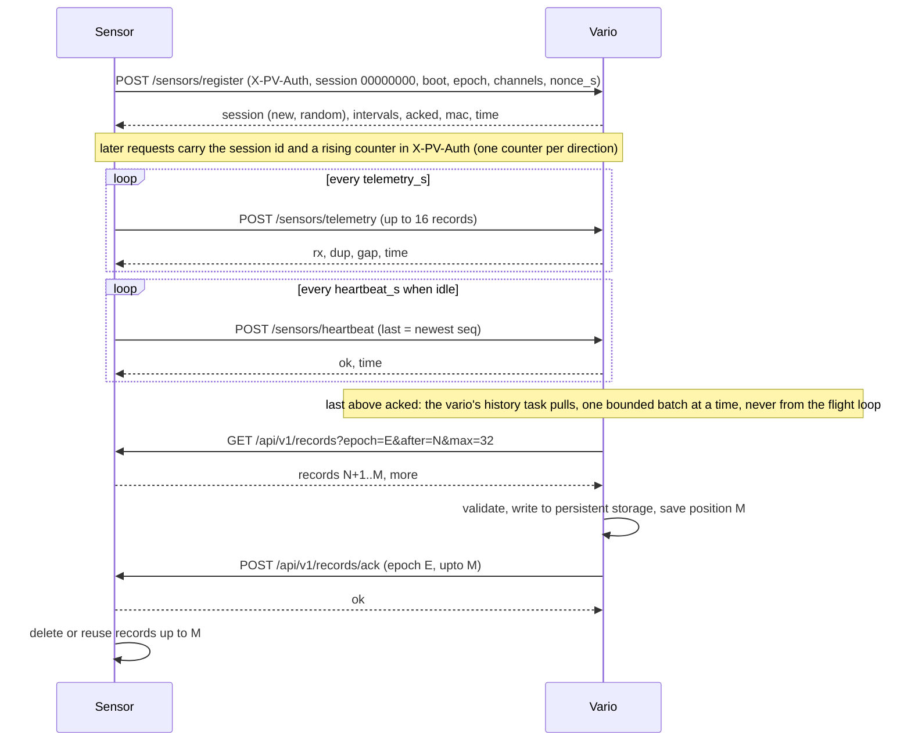
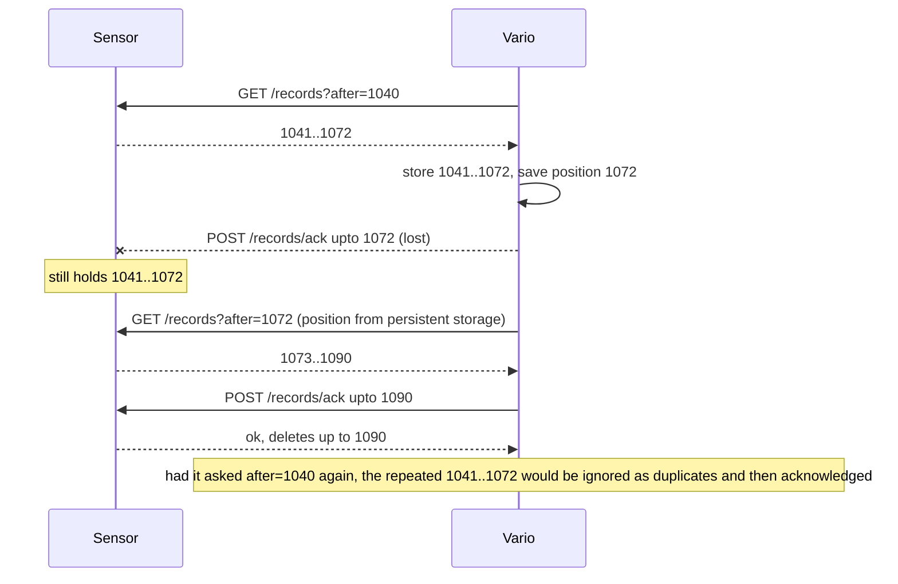
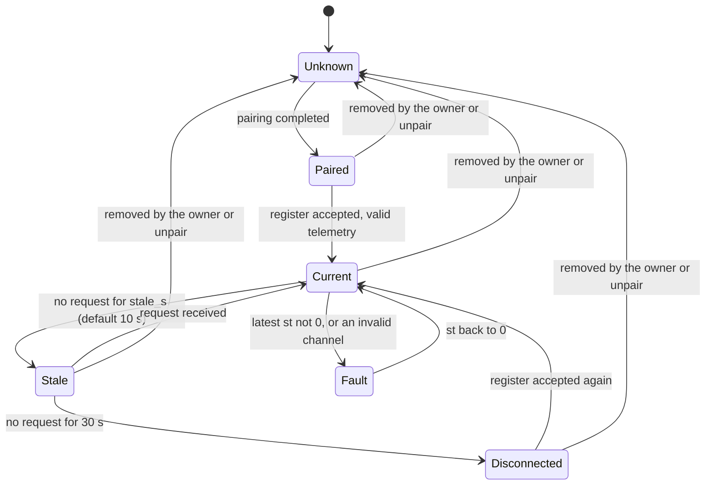

# Sensor API diagrams (Mermaid; version 1 draft)

Rendered by GitHub and most Markdown viewers. `README.md` is the specification; these show the order of events. Sensors call the vario's endpoints;
the vario calls the sensor-side endpoints (history, acknowledge).

## Pairing

```mermaid
sequenceDiagram
    actor Owner
    participant C as Client (sensor)
    participant V as Vario
    C->>V: GET /api/v1/system/identity
    V-->>C: vario_id, name, proto range, pairing_open
    Note over C: the client shows vario_id and name so the owner can confirm
    Owner->>V: open pairing mode (vario page): a random 64-bit secret is shown (16 hex characters)
    Owner->>C: type the secret into the client (out of band: it is never sent over the air)
    C->>V: POST /pair (device_id, proto, nonce_s) with X-PV-Auth = HMAC(secret, ...)
    V->>V: recompute with the secret it is showing; on a match bind device_id to the secret (persistent)
    V-->>C: vario_id, name, mac = HMAC(secret, pair, nonce_s, device_id, vario_id)
    C->>C: check mac: this vario knows the secret it was given
    Note over V: a wrong MAC is a failed attempt: 3, or 120 s, closes pairing mode
```

## A session: register, live telemetry, history



## History: lost acknowledgement and restart



## Device connection state (as seen by the vario)


